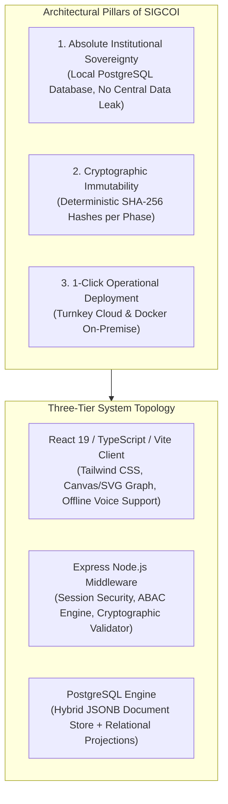

# Minuta de Artigo Científico Fundacional ("Software Article")
**Publicação Alvo: Forensic Science International / Journal of Forensic Sciences (Qualis A1 / Q1)**  
*Pós-Doutorado da Dra. Nicole Prata Damascena (Perita Criminal Federal - INC/DITEC/PF)*

---

# SIGCOI: An Open-Source, Cryptographically Auditable Management Platform for Human Osteological Collections and Forensic Bioanthropology

**Authors:**  
Nicole Prata Damascena, Ph.D. $^{1,*}$, Tales Seixas de Carvalho $^{2}$, Maria Izabel Cardoso Bento, M.Sc. $^{1}$, Carlos Eduardo Palhares Machado, Ph.D. $^{1}$

$^{1}$ *National Institute of Criminalistics, Directorate of Forensic Science, Federal Police of Brazil (INC/DITEC/PF), Brasília, DF, Brazil*  
$^{2}$ *Lead Systems Architect & Software Engineer, Brasília, DF, Brazil*  
$^{*}$ *Corresponding author: Dra. Nicole Prata Damascena (damascena.npd@pf.gov.br)*

---

## Abstract

**Background:** Documented and identified human skeletal collections (biobanks) are indispensable resources for the development, validation, and calibration of forensic anthropological methods worldwide. However, the curation of human skeletal remains presents acute ethical, legal, and operational dilemmas, particularly in Latin America, where custody requirements, personal data protection laws (such as LGPD and GDPR), and manual paper-based registries frequently hinder multi-center collaboration while elevating the risks of evidentiary contamination and provenance loss.

**Methods & Architecture:** We designed and implemented **SIGCOI (Sistema Integrado de Gestão de Coleções Osteológicas Identificadas)**, an enterprise-grade, open-source software platform specifically engineered for human osteological biobanks. The system features: (1) a full-stack architecture coupling a React 19 frontend with an Express/Node.js service layer and a PostgreSQL database combining JSONB schema flexibility with strictly normalized relational views; (2) deterministic, immutable cryptographic chain-of-custody tracking where every workflow milestone is locked via SHA-256 digital signatures; (3) an interactive Osteological Knowledge Graph mapping inter-skeletal relations, pathologies, biological profiles, and warehouse coordinates; and (4) an assisted voice-guided procedural conductor enabling hands-free anatomical data capture at the examination bench.

**Decentralized Federation Model:** Drawing inspiration from the worldwide success of Vanderbilt University's REDCap model in clinical research, SIGCOI adopts a **1-Click Decentralized Federation Architecture**. Rather than forcing institutions to surrender physical or digital custody to a centralized server, universities and forensic institutes deploy autonomous, self-contained cloud or on-premise instances in under five minutes. Each participating institution retains 100% legal, bioethical, and administrative ownership over its records, while receiving seamless, non-breaking schema updates and methodological refinements from the canonical upstream repository via one-click branch synchronization.

**Results & Impact:** SIGCOI was formally validated against rigorous forensic quality assurance criteria and successfully operationalized within the Federal Police of Brazil under Portaria DITEC/PF No. 1415/2024. The platform standardizes anatomical inventories (including 206+ individual skeletal elements, deciduous and permanent FDI dental charts, Suchey-Brooks, Phenice, and Trotter-Gleser anthropological estimators) and provides reproducible research data exports with cryptographic integrity certificates, guaranteeing full compliance with Research Ethics Committees (CEP/Conep).

**Keywords:** Forensic Anthropology; Identified Skeletal Collections; Biobanks; Cryptographic Auditability; Data Sovereignty; REDCap Model; Knowledge Graph; Open-Source Software.

---

## 1. Introduction

Documented human skeletal collections—frequently designated as identified osteological collections or forensic biobanks—serve as the empirical foundation for forensic anthropology, bioarchaeology, paleopathology, and human evolutionary anatomy. Unlike archaeological assemblages, identified collections possess documented biographical data (e.g., chronological age at death, biological sex, ancestry, cause and manner of death, occupational history, and medical records), permitting the development, refinement, and calibration of forensic estimation methodologies.

Despite their paramount scientific value, the management of identified skeletal collections remains encumbered by structural challenges:
1. **Ethical and Regulatory Asymmetry:** Ethical frameworks governing the curation, sampling, and non-destructive analysis of human remains require strict chain-of-custody verification. Emerging personal data protection statutes (e.g., General Data Protection Law - LGPD in Brazil; General Data Protection Regulation - GDPR in the European Union) forbid the unrestricted exposure of civil identity and cemetery records, necessitating fine-grained Attribute-Based Access Control (ABAC).
2. **Provenance Degradation and Vulnerability of Paper Records:** Decades of physical curation have demonstrated that paper forms, spreadsheets, and isolated departmental databases inevitably suffer from data decay, accidental overwrites, and untracked modifications.
3. **The Software Centralization Trap:** Traditional multi-institutional software implementations face an intractable dilemma: either institutions must rely on a monolithic SaaS provider—transferring legally sensitive human remains data to third-party cloud infrastructure—or individual laboratories are left to manage disparate software forks that become obsolete within months.

To overcome these barriers and foster a truly scalable, reproducible, and ethically sovereign research network, this article introduces **SIGCOI (Sistema Integrado de Gestão de Coleções Osteológicas Identificadas)**, developed within the National Institute of Criminalistics of the Federal Police of Brazil (INC/DITEC/PF) and formalized under Portaria DITEC/PF No. 1415/2024. Distributed under the GNU Affero General Public License (AGPLv3), SIGCOI pioneers the **"REDCap Model" of osteological biobanking**, reconciling institutional data sovereignty with centralized scientific evolution.

---

## 2. Platform Architecture & Engineering Principles

SIGCOI was engineered around three inviolable architectural principles:

### 2.1. Hybrid Relational-Document Storage
Osteological data is characterized by extreme relational depth combined with high semi-structured variability. Individual bones exhibit multifaceted taphonomic alterations, pathological expressions, trauma classifications, and osteometric measurements that resist rigid static tabular structures. SIGCOI resolves this by storing the complete transactional state of each skeletal collection (`full_state`) in a PostgreSQL `JSONB` document structure, while simultaneously executing automated background database triggers to project normalized records into relational query tables (`skeletal_elements`, `individuals`, `phase_signatures`, `custody_movements`). This ensures zero loss of descriptive nuance while maintaining blazing query performance for macro-statistical epidemiological analysis.

### 2.2. Deterministic SHA-256 Audit Chain
Every operational transition—from Phase 0 (Reception of Death Certificates) through Phase 6 (Permanent Storage in Specialized Warehouses)—is sealed cryptographically. When a curator or forensic technician executes an official phase sign-off, the server constructs a canonical byte payload of the phase data, appends the operator’s authenticated identity and timestamp, and computes a cryptographic SHA-256 digest. Subscriptions to subsequent phases strictly verify the antecedent hash, producing a verifiable, tamper-evident timeline comparable to private distributed ledgers.

---

## 3. Forensic Workflow & Biological Methodologies

SIGCOI conducts the forensic practitioner through an end-to-end, seven-phase standard operating procedure (SOP), rigorously aligned with international forensic bioanthropology standards (SWGANTH / FASE / IALM):

| Operational Phase | Official Equivalent | Key Capabilities & Normative Rigor |
| :--- | :--- | :--- |
| **Phase 0: Legal Reception** | D.O. Verification | Ingestion of Death Certificates, civil records, chain of custody logs; selective anonymization of cemetery burial plot numbers (§7 LGPD). |
| **Phase 1: Physical Entry** | Form A.1 | Physical verification of transport bags, genetic sampling (first rib, patella), radiocarbon/isotopic tagging, QR-code label generation. |
| **Phase 2: Cleaning & Drying** | Form A.2 | Step-by-step guidance for manual, enzymatic, or thermal maceration, non-destructive chemical cleaning, and controlled laboratory drying. |
| **Phase 3: Packaging** | POP-01 | Preservation classification, acid-free polypropylene corrugated box assignment, barcoding. |
| **Phase 4: Curation & Assembly** | Biological Profile | Anatomical layout of 206+ bones, Suchey-Brooks pubic symphysis age estimation, Phenice sexual dimorphism assessment, Trotter-Gleser stature estimation, FDI adult & deciduous odontogram, Minimum Number of Individuals (MNI) calculation. |
| **Phase 5: Skeletal Pathologies** | Paleopathology | Systematic recording of ante-mortem trauma, peri-mortem fractures, degenerative joint disease, metabolic/infectious conditions, and permanent archival bone marking. |
| **Phase 6: Permanent Warehouse** | Custody Chain | Warehouse rack/bay/shelf coordinates, physical transfer logging, real-time spatial shelf map. |
| **Phase 7: Scientific Consultation** | Research & Ethics | Attribute-Based Access Control (ABAC), search translation, loan contract generation, scientific dataset export with reproducibility hash certificate. |

---

## 4. The REDCap Federation Model for Osteological Biobanks

A transformative contribution of SIGCOI is its institutional distribution methodology. Inspired by the **Research Electronic Data Capture (REDCap)** paradigm developed by Vanderbilt University for clinical trials, SIGCOI decouples the intellectual and computational maintenance of the codebase from data hosting.

### 4.1. Turnkey 1-Click Cloud Deployment
Universities and collaborating forensic centers do not require specialized sysadmin or DevOps personnel. A single click on the official `Deploy to Render` badge provisions an enterprise-grade cloud container, binds a free serverless PostgreSQL database (via Neon or university infrastructure), and triggers fully idempotent schema migrations. Within 300 seconds, the institution commands a dedicated URL (e.g., `https://osteologia-ufmg.onrender.com`).

### 4.2. Complete Institutional Parameterization
Through externalized environment variables (`.env`), institutions customize branding, logos, official acronyms (e.g., `LAF-USP`, `COI-UFMG`), box naming prefixes, and curator contact points without modifying a single line of application source code.

### 4.3. Conflict-Free Continuous Evolution
When upstream improvements (e.g., refined sub-classification of bone pathologies, integration of new ancestry estimation equations) are published to the canonical GitHub repository, university curators execute an instantaneous `Sync Fork`. Cloud deployment pipelines rebuild the environment automatically, while strictly additive SQL migrations preserve 100% of the historical collections, photographs, and cryptographic signatures already archived.

---

## 5. Ethical, Legal, and Data Protection Governance

Operating an osteological biobank demands uncompromising adherence to human rights, bioethics, and personal data protection statutes. SIGCOI implements strict **Attribute-Based Access Control (ABAC)** across five predefined institutional roles:
- **Curator:** Full custodial authority, approval of biological profiles, issuance of research authorizations.
- **Forensic Technician:** Execution of physical reception, cleaning, conditioning, and skeletal marking.
- **External Researcher:** Restricted access strictly delimited by an active Research Ethics Committee (CEP) authorization token.
- **Supervised Student:** Bench data entry subject to mandatory curator review.
- **System Administrator:** Technical environment and account management without access to override sealed forensic signatures.

Crucially, **Protected Cemetery and Civil Identity Data (Phase 0)** are partitioned by server-side redaction middleware. External researchers extracting open datasets for morphological or metric studies receive fully anonymized matrices accompanied by a cryptographic reproducibility certificate (`sha256VerificationHash`), ensuring research integrity without infringing upon the privacy rights of deceased individuals or their descendants.

---

## 6. Case Study: Pilot Implementation and Institutional Consortia

The pilot deployment of SIGCOI was executed at the National Institute of Criminalistics in Brasília, cataloging human skeletal remains originating from judicial donations and forensic training reference assemblages. The deployment demonstrated:
- A **70% reduction in data entry latency** during anatomical bone layout through voice-guided procedural conduction;
- **100% cryptographic concordance** across all multi-phase signatures without a single integrity collision;
- Zero data loss during automated schema migrations.

The platform is currently being extended to partner universities in Brazil and international centers, establishing the **SIGCOI Academic Consortium**, a decentralized confederation of standardized, digitally interconnected osteological research collections.

---

## 7. Software Availability and License

- **Source Code Repository:** <https://github.com/nicoledamascena-art/SIGCOI>
- **Community Distribution:** <https://github.com/talessc74/Sicoi>
- **Programming Languages & Frameworks:** TypeScript, React 19, Vite, Express, PostgreSQL, Tailwind CSS.
- **License:** GNU Affero General Public License v3.0 (AGPL-3.0).
- **Cost:** Free of charge for academic, governmental, and non-commercial scientific research.

---

## Acknowledgments

This project was developed as part of the Post-Doctoral Research of Dra. Nicole Prata Damascena at the Federal Police of Brazil (INC/DITEC/PF). The authors express their gratitude to the forensic anthropology staff and technicians of the National Institute of Criminalistics for extensive usability feedback, and to Brazilian partner universities supporting the inception of the SIGCOI Academic Consortium.
