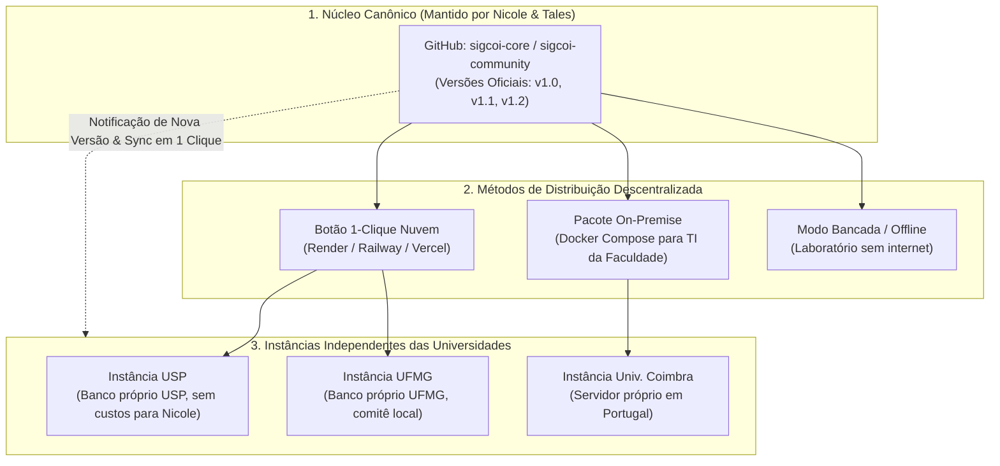
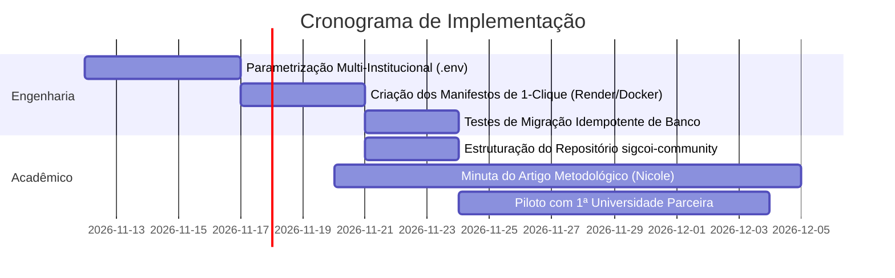

# Plano Estratégico & Arquitetural: Distribuição Acadêmica do SIGCOI
**Projeto de Internacionalização e Padronização Osteológica (Pós-Doutorado Dra. Nicole)**

---

## 1. Visão Executiva & Contexto

O **SIGCOI (Sistema de Gestão de Coleções Osteológicas Identificadas)** atingiu um nível de sofisticação técnica, anatômica e pericial ímpar. O objetivo da **Dra. Nicole (Perita Criminal Federal da PF)** de utilizar a ferramenta como pilar de seu **Pós-Doutorado**, disponibilizando-a para universidades no Brasil e no exterior, possui potencial de impacto científico comparável ao que o **REDCap** (Vanderbilt University) representou para a pesquisa clínica mundial.

### Os 3 Princípios Invioláveis da Estratégia
1. **Soberania e Custódia Local das Universidades**: Cada universidade é legal e eticamente responsável pelo seu acervo de restos humanos esqueletizados. Nenhum dado sensível de terceiros deve transitar ou ficar armazenado em servidores pessoais de Nicole ou Tales.
2. **Zero Ônus Operacional (Não virar Helpdesk 24/7)**: A equipe não deve assumir a responsabilidade de manter servidores de terceiros, resolver panes de conexão ou atuar como provedor SaaS comercial.
3. **Evolução Contínua Sincronizada**: O SIGCOI continuará sendo aprimorado na PF e na pesquisa da Nicole. O ecossistema distribuído deve receber melhorias sem quebrar o trabalho já catalogado em cada instituição.

---

## 2. Diagnóstico dos Modelos de Distribuição

| Critério | Modelo A: Repositório GitHub Puro (Fork) | Modelo B: SaaS Centralizado Único | Modelo C: **Federação 1-Clique (Recomendado)** |
| :--- | :--- | :--- | :--- |
| **Barreira de Entrada** | **Alta**: Exige que o antropólogo entenda de Git, Node.js e Docker. | **Nula**: Basta criar usuário e senha num site único. | **Nula**: O professor clica em um botão e seu sistema sobe em 3 min. |
| **Custo de Infraestrutura** | R$ 0 para vocês (a universidade arca). | **Altíssimo** para vocês (bancos, fotos, DICOM de dezenas de faculdades). | R$ 0 para vocês (cada universidade usa seu próprio plano gratuito/acadêmico). |
| **Responsabilidade Jurídica (LGPD / Ética)** | Totalmente da universidade. | **Crítica para vocês**: Guarda de laudos e ossadas de terceiros. | Totalmente da universidade instaladora. |
| **Atualizações e Correções** | **Caótico**: Forks divergem e ficam obsoletos rapidamente. | Fácil (atualiza em um só lugar). | **Excelente**: Notificação e atualização em 1 clique via GitHub Sync. |
| **Impacto no Pós-Doc** | Médio (muitas desistências por falta de TI). | Alto, mas com alto risco de esgotamento. | **Máximo**: Alto volume de adoção, escalável e sustentável. |

---

## 3. Arquitetura da Solução: Federação em 1-Clique ("REDCap Model")

A estratégia recomendada adota a **Federação de Instâncias Autônomas**. O SIGCOI é distribuído como uma plataforma empacotada pronta para nuvem de baixo custo/gratuita ou servidor local.



---

## 4. Como Viabilizar a Solução Tecnicamente

### 4.1. Parametrização Multi-Institucional por Variáveis de Ambiente
Atualmente, referências como "INC/DITEC/PF" e brasões específicos estão no código. A primeira tarefa prática é desacoplar essas referências para variáveis de ambiente com valores padrão seguros:

```bash
# Identidade da Instituição Instaladora
VITE_INSTITUTION_NAME="Universidade de São Paulo - IB/USP"
VITE_INSTITUTION_ACRONYM="LAF-USP"
VITE_COLLECTION_PREFIX="USP-OSTEO"
VITE_DEFAULT_LANGUAGE="pt-BR" # ou "en-US", "es-ES" para alcance internacional

# Customização Visual
VITE_HEADER_TITLE="Sistema de Gestão de Coleções Osteológicas"
VITE_LOGO_URL="/custom-logo.png"

# Contato do Curador Responsável Local
VITE_CURATOR_CONTACT_EMAIL="curadoria@ib.usp.br"
```
> Se a universidade não definir nada, o sistema carrega um rótulo neutro acadêmico internacional: *"SIGCOI - Sistema Integrado de Gestão de Coleções Osteológicas Identificadas"*.

### 4.2. O Botão Mágico: "Deploy to Render" & "Deploy to Railway"
No `README.md` do repositório público, criamos os botões oficiais:

[](https://render.com/deploy)
[](https://railway.app/template)

1. O professor de antropologia clica no botão;
2. Ele se cadastra no Render ou Railway (ambos possuem tiers gratuitos ou planos acadêmicos de baixíssimo custo);
3. O template provisiona automaticamente:
   - A aplicação web React compilada;
   - O banco de dados PostgreSQL integrado com o schema do SIGCOI executado via migração inicial idempotente;
4. Em menos de 5 minutos, a universidade tem sua URL própria ativa (ex: `https://osteologia-usp.onrender.com`).

### 4.3. Como Resolver a Evolução Contínua sem Deixar os Forks Órfãos
Para que as universidades não fiquem presas em versões antigas:

1. **Releases Semânticas Periódicas**: Nicole e Tales não distribuem código diário da branch `main`. A cada 30 ou 60 dias, publica-se uma tag estável (`v1.0.0`, `v1.1.0`, etc.).
2. **Notificador de Atualização Embutido no SIGCOI**:
   - Dentro da aba de *Configurações / Sobre o Sistema*, o SIGCOI consulta de forma assíncrona a API pública do repositório canônico:
   > 🔔 **Existe uma nova versão do SIGCOI disponível: v1.2.0**
   > *Novidades: Suporte ampliado a dentes decíduos, melhoria no cálculo de NMI e exportação direta em CSV.*
   > `[Ver Instruções de Atualização em 1 Clique]`
3. **Atualização Sem Conflitos**:
   - Para quem usou o deploy em nuvem, a atualização é feita clicando em *"Sync Fork"* no GitHub; a plataforma de nuvem detecta o commit e faz o redeploy automático, mantendo 100% dos dados já digitados no PostgreSQL.

---

## 5. Estratégia Acadêmica para o Pós-Doutorado da Nicole

Para transformar o SIGCOI em um marco curricular de alto impacto:

```
                          IMPACTO DO PÓS-DOUTORADO
                                     │
         ┌───────────────────────────┼───────────────────────────┐
         ▼                           ▼                           ▼
[ Artigo Fundacional ]    [ Rede / Consórcio SIGCOI ]    [ Formação & Citação ]
Publicação em periódico   Mapa de acervos afiliados      Obrigatoriedade de citação
internacional Q1          nacional e internacionalmente  em laudos, teses e TCCs
```

### 5.1. O Artigo Científico Fundacional ("Software Article")
- **Título Sugerido**: *"SIGCOI: An Open-Source, Blockchain-Ready Management System for Human Osteological Collections and Forensic Bioanthropology"*.
- **Revistas-Alvo**:
  - *Forensic Science International* (Q1)
  - *Journal of Forensic Sciences* (Q1)
  - *International Journal of Legal Medicine* (Q1)
- **Regra de Citação (Citation Policy)**: No rodapé do SIGCOI e na tela de exportação de dados, incluir o botão *"Como Citar este Software"*, gerando o BibTeX e ABNT do artigo da Nicole. Todo aluno de mestrado/doutorado que usar o acervo terá que citar o artigo dela.

### 5.2. O "Consórcio SIGCOI de Coleções Osteológicas"
Em vez de agir como fornecedora de software, Nicole atua como **Líder Científica de uma Rede**:
- Criação de um site vitrine simples (`sigcoi.org` ou subpágina acadêmica).
- Mapa interativo mostrando as instituições associadas ("Nós da Rede SIGCOI"): USP, UNICAMP, UFMG, UFRJ, universidades portuguesas e latino-americanas.
- O relatório do Pós-Doc ganha o peso de um projeto de **intercâmbio institucional e cooperação científica**.

### 5.3. Licenciamento Recomendado: AGPLv3 (ou PolyForm Noncommercial)
- **GNU AGPLv3**: Garante que o SIGCOI continue **aberto e gratuito para sempre**. Se qualquer universidade ou empresa modificar o código, é legalmente obrigada a compartilhar as melhorias de volta com o projeto da Nicole.
- Proíbe a apropriação comercial privada da ferramenta sem autorização.

---

## 6. Plano de Ação Imediato



### Passo 1: Limpeza e Parametrização no Repositório Clonado
- Subir a base de código limpa para o novo repositório GitHub.
- Isolar as strings institucionais da PF em variáveis de ambiente configuráveis.
- Manter o padrão forense robusto intacto (Phenice, Suchey-Brooks, Trotter & Gleser, notação dentária FDI, integridade determinística de hashes).

### Passo 2: Construção dos Modelos de Deploy
- Criar o arquivo `render.yaml` e o `docker-compose.yml`.
- Testar o deploy limpo em uma conta de teste do Render para garantir que qualquer usuário leigo consiga rodar com um clique.

### Passo 3: Teste Piloto
- Convidar uma universidade parceira próxima para fazer o teste guiado de 15 minutos: *"Clique aqui e veja seu laboratório funcionar"*.
- Coletar feedback do docente para instruir o manual de instalação.

---

> **Conclusão**: Com essa arquitetura, Nicole alcança a meta máxima de disseminação acadêmica para seu Pós-Doutorado, padroniza as coleções osteológicas do país e do mundo sob a metodologia desenvolvida na PF, e você e ela ficam livres de encargos de suporte, custódia e infraestrutura.