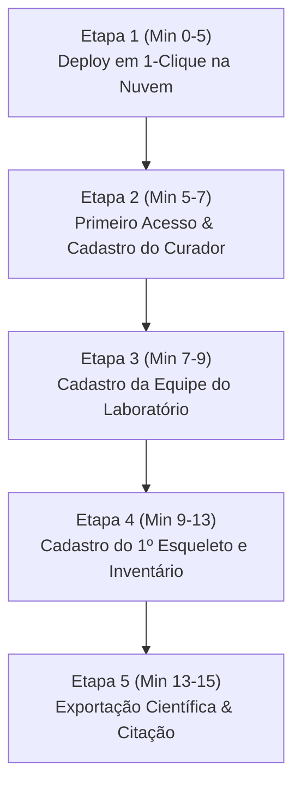

# Roteiro de Validação & Teste Piloto (Onboarding de 15 Minutos)
**Projeto de Distribuição Universitária do SIGCOI (Pós-Doutorado Dra. Nicole Damascena)**  
*Documento de Apoio para Condução do Piloto com a 1ª Universidade Parceira*

---

## 1. Objetivo do Teste Piloto

Validar na prática a hipótese central do **Modelo de Federação REDCap**:
> *"Um docente ou pesquisador de antropologia física, sem conhecimentos avançados de infraestrutura ou programação, consegue colocar no ar uma instância completa, soberana e personalizada do SIGCOI para o seu laboratório em menos de 15 minutos."*

---

## 2. Instituições Candidatas Prioritárias

1. **Laboratório de Antropologia Forense - USP (IB/USP)**: Referência nacional em antropologia esquelética e bioarqueologia.
2. **Laboratório de Bioantropologia - UFMG**: Ampla experiência em osteometria e estudos populacionais.
3. **Universidade Estadual de Campinas (UNICAMP - FOP)**: Forte tradição em odontologia e antropologia forense.
4. **Laboratório de Antropologia Forense - Universidade de Coimbra (Portugal)**: Expansão internacional do Pós-Doutorado (coleções identificadas de referência mundial).

---

## 3. Roteiro Passo a Passo do Teste (Cronometrado: 15 Minutos)



### Minuto 0 ao 5: Provisionamento em 1-Clique
- O professor abre o link do Render via botão oficial `Deploy to Render`.
- Cola a URL do banco PostgreSQL gratuito (criado em 1 minuto no Neon).
- Define as siglas institucionais de seu laboratório (ex.: `LAF-USP`).
- **Critério de Sucesso**: O Render conclui a compilação e entrega a URL `https://osteologia-suafaculdade.onrender.com` ativa.

### Minuto 5 ao 7: Primeiro Acesso (Ativação do Curador)
- O professor acessa a URL gerada pela primeira vez.
- Preenche a tela nativa *"Criar Primeiro Administrador"*.
- **Critério de Sucesso**: Login realizado com sucesso e cabeçalho carregado exibindo a sigla da sua universidade.

### Minuto 7 ao 9: Configuração da Equipe
- No menu **Configurações**, clica em `+ Nova Pessoa`.
- Cadastra 1 Técnico de Laboratório e 1 Estudante de Iniciação Científica/Pós-Graduação.
- **Critério de Sucesso**: Links de primeiro acesso gerados e papéis atribuídos corretamente pela matriz ABAC.

### Minuto 9 ao 13: Fluxo Operacional de Teste (Cadastro de 1 Conjunto)
- Clica em `+ Novo Conjunto` (ex.: `COI-001`).
- Passa pela **Fase 1 (Recebimento)** e visualiza a etiqueta com QR Code.
- Avança para a **Fase 4 (Curadoria)** e experimenta a marcação anatômica do esqueleto (crânio, dentes, ossos longos) e cálculo do perfil biológico.
- **Critério de Sucesso**: Dados persistidos sem erros e hashes SHA-256 gerados nas assinaturas de fase.

### Minuto 13 ao 15: Exportação Científica e Política de Citação
- Acessa a **Fase 7 (Consulta e Pesquisa)**.
- Gera o arquivo JSON de pesquisa com o hash de integridade de dados.
- Clica no botão **"Como Citar este Software"** e testa a cópia dos formatos ABNT e BibTeX.
- **Critério de Sucesso**: Citação do artigo da Dra. Nicole copiada para a área de transferência com sucesso.

---

## 4. Questionário de Avaliação Rápida (SUS - System Usability Scale)

Ao final do teste, solicitar ao professor que atribua uma nota de 1 (Discordo Totalmente) a 5 (Concordo Totalmente) para as seguintes afirmações:

| Afirmação de Avaliação | Nota (1 a 5) | Observações do Docente |
| :--- | :---: | :--- |
| 1. *O processo de colocar o sistema no ar foi simples e rápido.* | [ ] | |
| 2. *Senti segurança em relação à soberania e privacidade dos dados da minha universidade.* | [ ] | |
| 3. *A interface de inventário ósseo e dentário atende às necessidades do meu laboratório.* | [ ] | |
| 4. *A política de citação do software é clara e adequada para meus alunos usarem em teses.* | [ ] | |
| 5. *Eu recomendaria o SIGCOI para outros laboratórios de bioantropologia.* | [ ] | |

---

## 5. Minuta de Convite Oficial (Para Envio por E-mail ou Ofício)

```text
Assunto: Convite para Piloto Acadêmico: Implantação da Plataforma SIGCOI em seu Laboratório (Pós-Doutorado PF)

Prezado(a) Professor(a) [Nome do Docente / Coordenador do Laboratório],

Como parte de meu projeto de Pós-Doutorado junto ao Instituto Nacional de Criminalística da Polícia Federal (INC/DITEC/PF), temos o prazer de convidá-lo(a) para participar do programa piloto de distribuição acadêmica do SIGCOI (Sistema Integrado de Gestão de Coleções Osteológicas Identificadas).

O SIGCOI é uma plataforma de código aberto (licença AGPLv3) desenvolvida para transformar e modernizar a gestão de biobancos de restos humanos esqueletizados. Inspirado no modelo de federação do REDCap, o sistema foi desenhado para garantir total soberania à sua universidade:
1. O banco de dados é exclusivo e local da sua instituição (nenhum dado de ossadas ou laudos trafega para a Polícia Federal ou servidores externos);
2. A implantação é gratuita e pode ser feita em menos de 10 minutos com um clique;
3. O inventário padroniza mais de 206 elementos esqueléticos, odontograma FDI e estimativas antropológicas consagradas (Phenice, Suchey-Brooks, Trotter & Gleser), com trilha de auditoria criptográfica SHA-256 e conformidade com comitês de ética em pesquisa (CEP).

Gostaríamos de agendar uma breve sessão remota de 15 a 20 minutos para que você e sua equipe possam experimentar colocar uma instância piloto no ar e avaliar sua aplicabilidade para o acervo de sua faculdade.

Caso tenha interesse, responda a este e-mail indicando seus horários de preferência.

Atenciosamente,

Dra. Nicole Prata Damascena
Perita Criminal Federal - Antropologia Forense
Instituto Nacional de Criminalística (INC/DITEC/PF)

Tales Seixas de Carvalho
Arquiteto de Software & Engenheiro Líder
```
